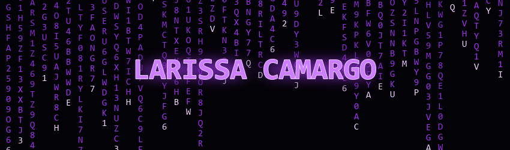

### Oi! Eu sou a Larissa 👋

Estudante de **Ciência da Computação**, atualmente no **2º semestre** e estagiária como **desenvolvedora**. Estou construindo minha jornada na tecnologia, aprendendo na prática e evoluindo a cada projeto.

---

### 💜 Sobre mim

- 🎓 Ciência da Computação — 2º semestre
- 💻 Estagiária desenvolvedora
- ✨ Em constante aprendizado e aberta a novos desafios na tecnologia

### 🛠️ Tecnologias

  
  

### 📬 Contato

  
  
  

### 🚀 Projetos

*Meus projetos aparecerão aqui conforme eu for compartilhando meu trabalho.*

---

🌙 *Aprendendo, criando e evoluindo um passo de cada vez.*

